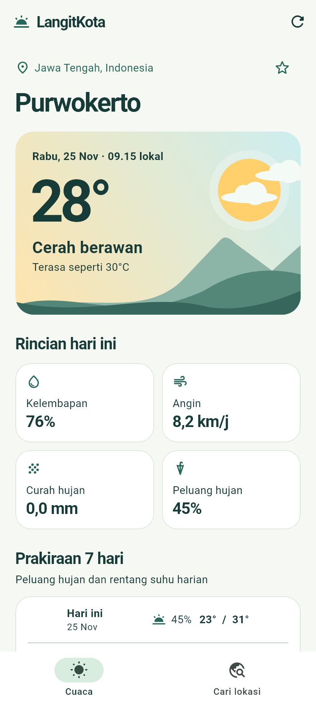
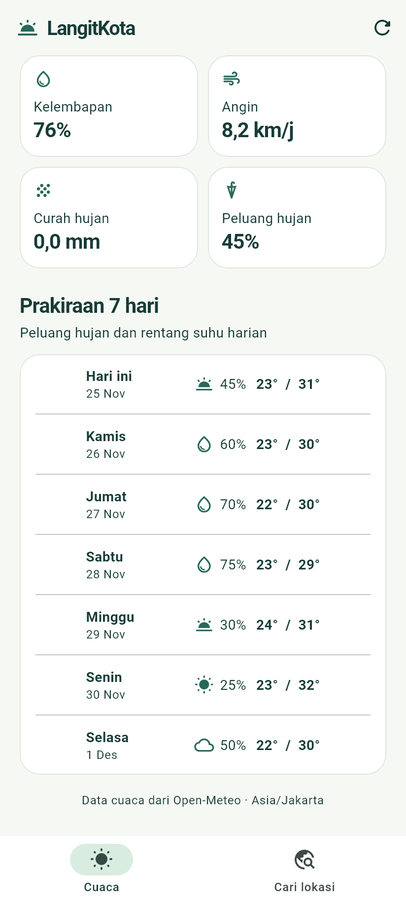
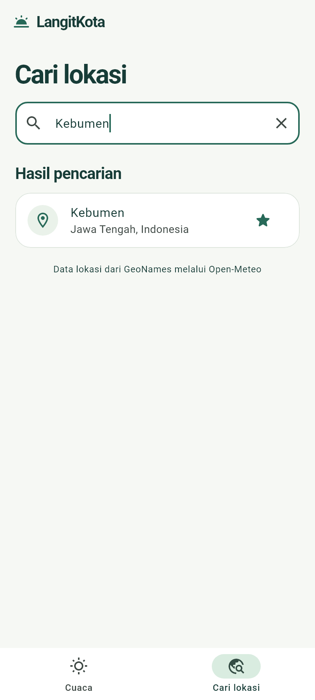

# LangitKota

Aplikasi cuaca Flutter berbahasa Indonesia untuk responsi Praktikum Pemrograman Mobile. Saat pertama dibuka, aplikasi mengambil cuaca Purwokerto. Setelah pengguna memilih kota lain, aplikasi membuka kota tersebut pada sesi berikutnya. Warna langit dan ilustrasi pada kartu cuaca mengikuti kondisi serta waktu siang atau malam dari Open-Meteo.

## Menjalankan aplikasi

Proyek menggunakan Flutter 3.47.8, Dart 3.13.7, dan Android NDK `30.0.16248370`. Target yang tersedia adalah Android dan web. Untuk Android, aktifkan USB debugging dan sambungkan perangkat. Jalankan perintah berikut dari folder yang berisi `pubspec.yaml`.

```sh
flutter pub get
flutter devices
flutter run
```

Jika ada beberapa perangkat, gunakan `flutter run -d <id-perangkat>`. Untuk web, gunakan `flutter run -d chrome`. Pencarian dan pembaruan cuaca memerlukan koneksi internet. Aplikasi dapat membaca daftar favorit secara lokal.

## Tampilan aplikasi

Cuplikan berikut diambil dari widget aplikasi pada ukuran layar ponsel. Pengujian memberikan contoh respons API agar tampilan bisa direproduksi. Saat aplikasi dijalankan biasa, data diambil dari Open-Meteo.

| Cuaca terkini | Prakiraan setelah digulir | Pencarian lokasi |
| --- | --- | --- |
|  |  |  |

Pada layar **Cuaca**, tarik daftar ke bawah atau ketuk ikon muat ulang untuk memperbarui data. Suhu minimum berada di kiri dan maksimum di kanan pada setiap baris prakiraan. **Curah hujan** dinyatakan dalam milimeter, sedangkan **peluang hujan** menunjukkan probabilitas maksimum pada hari tersebut.

Pada layar **Cari lokasi**, masukkan minimal dua karakter. Ketuk nama kota untuk membuka cuacanya atau ketuk bintang untuk menyimpannya. Kosongkan kolom pencarian untuk melihat favorit. Ketuk bintang kembali untuk menghapus kota dari daftar favorit.

## Struktur dan penerapan MVVM

| Bagian | Berkas utama | Tanggung jawab |
| --- | --- | --- |
| Model | `lib/models/city.dart`, `lib/models/weather.dart` | Memetakan JSON menjadi `City`, `Weather`, dan `ForecastDay`. Nilai cuaca yang tidak tersedia ditampilkan dengan tanda pisah. |
| Akses data | `lib/data/weather_api.dart` | Mengirim HTTP GET, memeriksa status respons, membaca JSON UTF-8, dan meneruskannya ke model. |
| Penyimpanan | `lib/data/location_store.dart` | Menyimpan kota terakhir dan daftar favorit sebagai JSON. Pada Android, MethodChannel menghubungkan Dart dengan SharedPreferences di MainActivity.kt. Versi web menggunakan localStorage browser. |
| ViewModel | `lib/viewmodels/weather_view_model.dart` | Mengelola kota aktif, hasil pencarian, favorit, dan status pemuatan. Nomor permintaan mencegah respons lama menimpa pilihan terbaru. |
| View | `lib/views/weather_screen.dart`, `lib/views/search_screen.dart` | Menampilkan state dan meneruskan interaksi pengguna kepada ViewModel. `sky.dart` menerjemahkan kode cuaca menjadi label, ikon, dan ilustrasi. |
| Inisialisasi | `lib/main.dart` | Membuat layanan dan ViewModel, mengatur Material Theme, dan menghubungkan kedua layar melalui navigasi bawah. |

Contohnya, saat pengguna mengetuk Kebumen, `select()` mengganti kota aktif dan menjalankan `refresh()`. Layar menampilkan indikator pemuatan. Setelah model cuaca tersedia, ViewModel memanggil `notifyListeners()`. `ListenableBuilder` kemudian membangun ulang tampilan. Jika pengambilan data gagal, layar menyediakan tombol **Coba lagi**.

## Integrasi API

| Operasi | Endpoint GET | Parameter dan hasil |
| --- | --- | --- |
| Cari kota | `https://geocoding-api.open-meteo.com/v1/search` | `name`, `count=12`, `language=id`, dan `format=json`. Setiap hasil menyediakan ID, nama, koordinat, serta wilayah dan negara jika tersedia. |
| Ambil cuaca | `https://api.open-meteo.com/v1/forecast` | Koordinat kota, `timezone=auto`, `forecast_days=7`, serta daftar field `current` dan `daily`. |

Data **current** meliputi `temperature_2m`, `relative_humidity_2m`, `apparent_temperature`, `precipitation`, `weather_code`, `wind_speed_10m`, dan `is_day`. Data **daily** memuat `temperature_2m_min`, `temperature_2m_max`, `precipitation_probability_max`, serta `weather_code`.

Pencarian menunggu 350 milidetik setelah ketikan terakhir. Menekan tombol cari pada keyboard mengirim permintaan segera. Setiap permintaan memiliki batas waktu 15 detik. Aplikasi membedakan proses memuat, hasil kosong, dan kegagalan permintaan.

Dokumentasi dan atribusi data tersedia di [Open-Meteo Forecast API](https://open-meteo.com/en/docs) dan [Open-Meteo Geocoding API / GeoNames](https://open-meteo.com/en/docs/geocoding-api).

## Pengujian dan video

```sh
flutter analyze
flutter test
```

Pengujian di `test/widget_test.dart` mencakup pencarian, memilih kota, menyimpan dan menghapus favorit, membuka ulang aplikasi, respons kosong, kegagalan HTTP, dan respons yang tiba di luar urutan. Untuk merekam ulang gambar dokumentasi, jalankan `flutter test --dart-define=CAPTURE_DOCS=true` dengan variabel lingkungan `FLUTTER_ROOT` mengarah ke folder SDK Flutter.

[Video penjelasan kode LangitKota](https://youtu.be/WXxj49L0Sc8).
